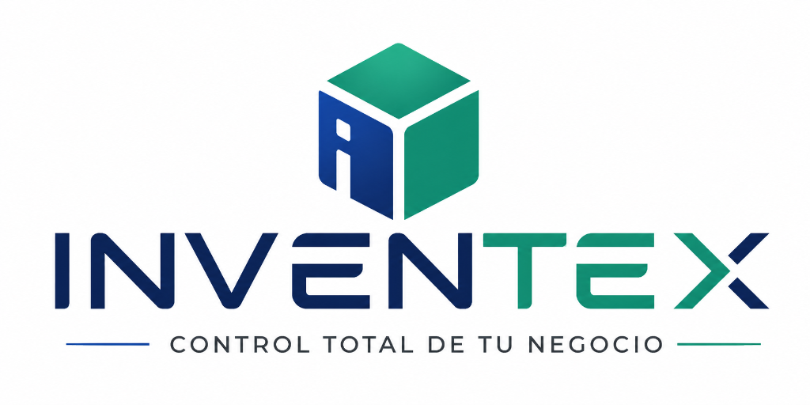

# 🚀 INVENTEX - Sistema Multi-Tenant SaaS & POS Comercial

<p align="center">
  
</p>

<p align="center">
  <strong>Plataforma SaaS Multi-Empresa para Gestión de Inventario, Facturación y Punto de Venta (POS)</strong>
</p>

<p align="center">
  
  
  
  
  
  
</p>

---

## 📌 Descripción del Proyecto

**INVENTEX** es una solución web empresarial completa desarrollada bajo el modelo **SaaS Multi-Tenant**. Permite a múltiples negocios independientes (bodegas, minimarkets, ferreterías, comercios minoristas) gestionar sus operaciones comerciales de forma completamente aislada y segura, mientras que un **Super Administrador Global** supervisa el rendimiento, licencias y facturación de toda la plataforma.

---

## 🏛️ Arquitectura & Principios de Diseño

### 1. Multi-Tenancy Estricto por Base de Datos Compartida
- **Aislamiento Automático de Datos**: Implementación del patrón `TenantScope` y el trait `BelongsToTenant` en Eloquent ORM. Todas las consultas (`SELECT`, `INSERT`, `UPDATE`, `DELETE`) en modelos transaccionales están scoped automáticamente al `empresa_id` del usuario autenticado.
- **Middleware de Protección**: `TenantMiddleware` valida y protege las rutas operativas, bloqueando cualquier intento de manipulación por parámetros o URLs cruzadas.

### 2. Dos Niveles de Usuario Totalmente Separados
- **Nivel 1: Super Admin Global INVENTEX**
  - Panel exclusivo (`/saas`) con KPIs de plataforma: Total de empresas, licencias activas/vencidas, métricas del servidor, ingresos por suscripción y auditoría de eventos (`ActividadSistema`).
  - **Modo Suplantación (Impersonation)**: Capacidad de auditar y dar soporte a una empresa ("Administrar Empresa") con un banner persistente de control: `[ Cambiar Empresa ]` y `[ Volver al Panel Global ]`.
- **Nivel 2: Inquilino / Bodega Comercial**
  - Acceso inmediato al módulo operativo (`/pos`, `/dashboard`). Bloqueo estricto contra módulos del SaaS (HTTP 403).

### 3. Roles y Permisos Granulares
- `Super Admin`: Administración global de la infraestructura SaaS.
- `Administrador Empresa`: Dueño del negocio, reportes y configuración.
- `Gerente`: Supervisión de inventario y caja.
- `Cajero`: Emisión de comprobantes y cobros en punto de venta.
- `Empleado`: Despacho y registro de stock.

---

## ✨ Características Principales

### 🛒 Punto de Venta (POS) de Alto Rendimiento
- Terminal de ventas ultra-rápido en Vue 3 con reactividad en tiempo real.
- Búsqueda instantánea de productos por código de barras o nombre.
- Carrito de compras reactivo con cálculo automático de subtotales, descuentos e impuestos.
- Métodos de pago múltiples (Efectivo, Tarjeta, Yape/Plin, Transferencia).
- Generación de comprobantes digitales e impresión de tickets de venta.

### 📦 Gestión de Inventario & Kardex
- Catálogo de productos con soporte para variantes, categorías y unidades de medida.
- Control de stock mínimo con alertas automáticas de reposición en el Dashboard.
- Movimientos de inventario (`Kardex`) para auditoría de entradas y salidas.

### 💵 Control de Caja Diaria (Cash Management)
- Apertura, monitoreo y arqueo/cierre de turnos de caja.
- Registro de ingresos y gastos menores en efectivo.
- Control de diferencias y balance de caja por turno de cajero.

### 📊 Dashboard Operativo & KPIs
- Métricas en tiempo real: Ventas del día, compras, margen de ganancia y productos con bajo stock.
- Historial reciente de actividades y auditoría de cambios del sistema.

### ⚙️ Configuración Moderna (Single-Page Tabs)
- Rediseño con navegación horizontal responsive: Empresa, Mi Perfil, Seguridad, Personalización (paleta de colores con persistencia local) y Zona de Peligro con doble confirmación.

---

## 🧪 Pruebas Automatizadas (Testing)

El proyecto cuenta con una suite integral de pruebas con **PHPUnit**:
- `MultiTenantSuperAdminTest`: Valida el redireccionamiento por rol, aislamiento de inquilinos, seguridad de rutas y suplantación segura.
- `CatalogTenantIsolationTest`: Verifica que ninguna empresa pueda consultar o modificar productos, categorías o clientes de otra empresa.
- `SaaSDashboardTest`: Evalúa el cálculo de KPIs globales, auditoría de actividades y gestión de planes.

Para ejecutar los tests:
```bash
php artisan test
```

---

## 🛠️ Stack Tecnológico

| Capa | Tecnologías |
| :--- | :--- |
| **Backend** | PHP 8.3+, Laravel 11.x, Eloquent ORM, Gates & Policies |
| **Frontend** | Vue 3 (Composition API / `<script setup>`), Inertia.js |
| **Estilos & UI** | Tailwind CSS, Lucide Icons, Headless UI |
| **Base de Datos** | MySQL 8.4+ / MariaDB |
| **Build Tool** | Vite 5 |

---

## 💻 Instalación Local

```bash
# 1. Clonar el repositorio
git clone <URL_DEL_REPOSITORIO>
cd Inventex

# 2. Instalar dependencias de PHP
composer install

# 3. Instalar dependencias de Node
npm install

# 4. Configurar variables de entorno
cp .env.example .env
php artisan key:generate

# 5. Ejecutar migraciones y seeders
php artisan migrate --seed

# 6. Compilar assets para producción
npm run build

# 7. Iniciar el servidor local
php artisan serve
```

---

## 👤 Autor

Desarrollado por **Antony**  
- Correo: `76213869@continental.edu.pe`  
- Proyecto: **INVENTEX Multi-Tenant SaaS**
