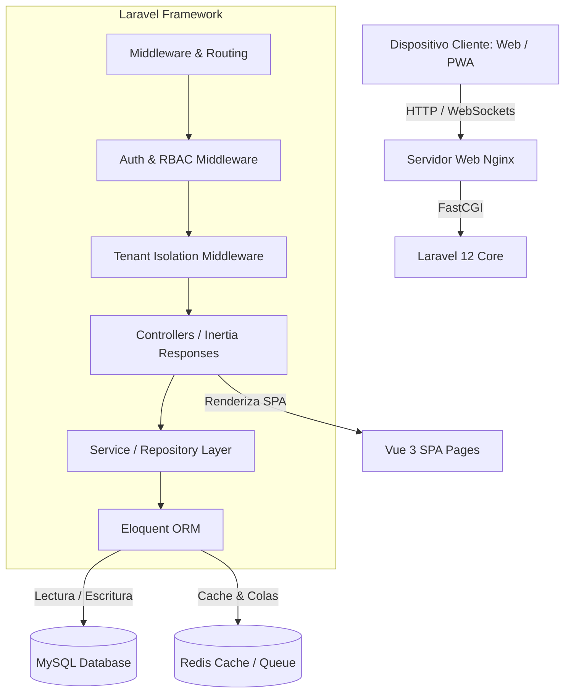
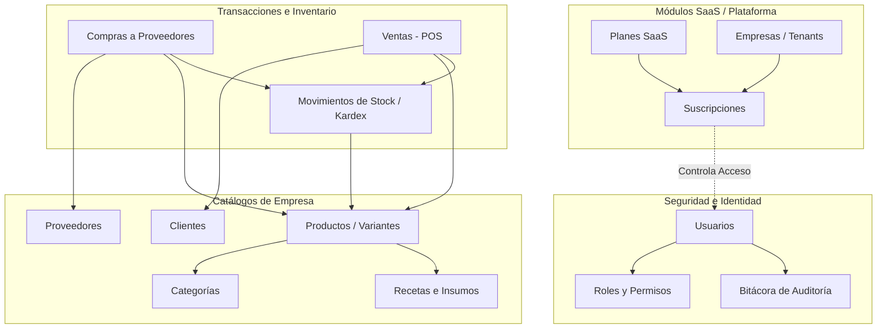
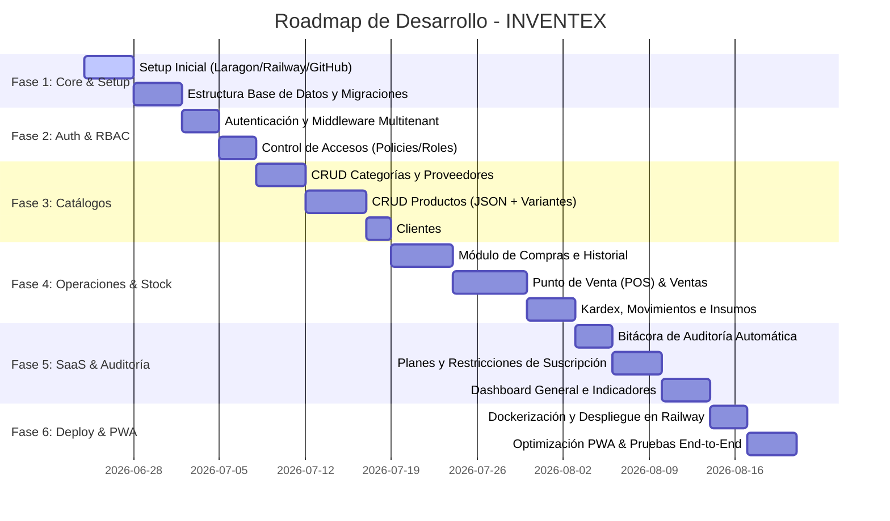

# INVENTEX - Plataforma SaaS Multiempresa
> **Slogan:** Gestiona. Vende. Crece.

INVENTEX es una plataforma SaaS multiempresa de gestión de inventarios y punto de venta diseñada inicialmente para bodegas en el Perú, con una arquitectura flexible y escalable capaz de soportar en el futuro otros rubros comerciales (minimarkets, ferreterías, librerías, tiendas de ropa y restaurantes) sin necesidad de modificar el esquema básico de la base de datos.

---

## User Review Required

> [!IMPORTANT]
> **Esquema de Base de Datos y Flexibilidad**:
> Para lograr la escalabilidad hacia múltiples sectores (como tiendas de ropa y restaurantes) sin alterar la base de datos en el futuro, se ha incorporado una estructura con:
> 1. Campo `metadatos` de tipo **JSON** en la tabla `productos` para guardar campos dinámicos (tallas, colores, ISBN, lote, fecha de vencimiento, etc.).
> 2. Relación recursiva en `productos` (`parent_id`) para soportar variantes de productos (talla/color) agrupadas bajo un producto padre.
> 3. Una tabla `recetas` que relaciona productos para definir recetas (restaurantes) o combos/kits (ferreterías/tiendas de ropa).
> 4. Campo `tipo_negocio` en la tabla `empresas` para habilitar componentes e interfaces específicas por rubro.

---

## Open Questions

> [!NOTE]
> 1. **Pasarela de Pagos para Suscripciones**: ¿Se planea integrar alguna pasarela local (como Culqi o Niubiz) o internacional (Stripe) en el MVP para la gestión automática de las suscripciones, o se iniciará con registro manual/administrativo?
> 2. **Facturación Electrónica (SUNAT)**: Aunque no está listada explícitamente en el MVP V1, ¿desea dejar preparadas las tablas de ventas con campos de comprobantes electrónicos (boleta, factura, serie, correlativo)? *(Recomendamos incluirlos de una vez en el diseño de base de datos para evitar migraciones complejas luego)*.

---

## 1. Documento de Requerimientos (PRD)

### Requerimientos Funcionales por Módulo

#### Módulo 1: Empresas (Multi-tenant)
- **RF-1.1**: Registro y aprovisionamiento de un nuevo tenant (empresa) con datos fiscales de Perú (RUC, Razón Social, Dirección, Tipo de Negocio).
- **RF-1.2**: Edición de la configuración del negocio (moneda por defecto, impuestos aplicables, logo, datos de contacto).
- **RF-1.3**: Aislamiento estricto de datos: ningún usuario de una Empresa A podrá ver, editar o interactuar con los datos de la Empresa B.

#### Módulo 2: Usuarios y Autenticación
- **RF-2.1**: Autenticación segura (Login / Logout) con credenciales cifradas (Bcrypt).
- **RF-2.2**: Recuperación de contraseña vía correo electrónico con token seguro expirante.
- **RF-2.3**: Gestión de usuarios internos de cada empresa por parte del Administrador (Crear, Editar, Desactivar).

#### Módulo 3: Roles y Permisos (RBAC)
- **RF-3.1**: Control de accesos basado en roles.
- **RF-3.2**: Definición de roles por defecto:
  - **Super Admin**: Administra la plataforma global, planes, suscripciones y empresas.
  - **Administrador**: Control total sobre su propia empresa (usuarios, productos, compras, ventas).
  - **Cajero**: Acceso restringido al Punto de Venta (POS), clientes y visualización de stock básico.
  - **Almacenero**: Acceso a productos, categorías, compras y movimientos de stock (Kardex).
  - **Vendedor**: Acceso a ventas, clientes y catálogo de productos.

#### Módulo 4: Dashboard Operativo
- **RF-4.1**: Visualización gráfica y numérica de las Ventas del día y Compras del día de la empresa.
- **RF-4.2**: Contador de productos registrados y alertas de stock crítico (productos por debajo de su stock mínimo).
- **RF-4.3**: Listado de las últimas 5 actividades registradas en la bitácora de la empresa.

#### Módulo 5: Categorías
- **RF-5.1**: CRUD completo de categorías de productos específicas de cada empresa.

#### Módulo 6: Productos
- **RF-6.1**: CRUD completo de productos con campos para código de barras, precio de compra, precio de venta, stock mínimo y actual, unidad de medida.
- **RF-6.2**: Soporte de variantes mediante relación parent-child y metadatos dinámicos JSON.

#### Módulo 7: Proveedores
- **RF-7.1**: CRUD de proveedores con RUC, nombre comercial, contacto, teléfono e email.

#### Módulo 8: Compras (Abastecimiento)
- **RF-8.1**: Registro de compras de productos a proveedores, indicando cantidades y precios de costo.
- **RF-8.2**: Afectación automática del stock (ingreso) al completar la compra.
- **RF-8.3**: Historial y detalle de compras realizadas.

#### Módulo 9: Clientes
- **RF-9.1**: CRUD de clientes con soporte para DNI (personas naturales) y RUC (empresas).

#### Módulo 10: Ventas y Punto de Venta (POS)
- **RF-10.1**: Interfaz POS responsiva y rápida para registrar ventas agregando productos (soporte para lector de código de barras).
- **RF-10.2**: Deducción automática de stock en tiempo real al finalizar una venta.
- **RF-10.3**: Registro del método de pago (Efectivo, Tarjeta, Yape/Plin, Transferencia).
- **RF-10.4**: Historial y vista detallada de ventas con opción de anulación (que devuelve el stock).

#### Módulo 11: Movimientos de Stock (Kardex)
- **RF-11.1**: Registro detallado de cada entrada, salida y ajuste de inventario.
- **RF-11.2**: Consulta del Kardex por producto ordenado cronológicamente.
- **RF-11.3**: Módulo de ajustes manuales de stock para mermas o inventariado físico.

#### Módulo 12: Bitácora de Auditoría
- **RF-12.1**: Registro automático no-editable de acciones críticas (creaciones, modificaciones, eliminaciones, accesos).
- **RF-12.2**: Registro de valores anteriores y nuevos en formato JSON, IP del usuario y navegador.

#### Módulo 13: Planes SaaS
- **RF-13.1**: CRUD de planes de suscripción (Básico, Pro, Premium) con límites de usuarios, productos e historial de ventas.

#### Módulo 14: Suscripciones
- **RF-14.1**: Asociación de empresas a planes con fecha de inicio, fin y estado de pago.
- **RF-14.2**: Bloqueo de acceso operativo si la suscripción de la empresa está expirada.

---

### Requerimientos No Funcionales (NFR)
- **Seguridad**: Cifrado SSL, protección contra CSRF (integrado en Laravel), prevención de SQL Injection mediante Eloquent ORM, y control estricto de políticas de acceso (Laravel Policies) para el aislamiento de tenants.
- **Rendimiento**: Caching de catálogos frecuentes en Redis, optimización de índices de base de datos MySQL en columnas de búsqueda frecuentes (`codigo_barras`, `empresa_id`).
- **Escalabilidad**: Base de datos diseñada para indexación óptima. Código desacoplado mediante servicios para facilitar la migración futura a microservicios si fuera necesario.
- **PWA-Ready**: Estructura de archivos preparada para service workers y manifest para permitir la instalación en dispositivos móviles Android/iOS.

---

## 2. Arquitectura Completa

La plataforma utilizará una **Arquitectura Monolítica Híbrida** con **Laravel 12** y **Vue 3** integrados mediante **Inertia.js**. Esta elección combina la robustez y velocidad de desarrollo de un backend en Laravel con la experiencia de usuario fluida (Single Page Application) que proporciona Vue.

### Estrategia de Multi-tenancy (Single Database, Shared Schema)
Para optimizar costos de infraestructura en Railway y simplificar el mantenimiento, se implementará un enfoque de **Base de Datos Única con Discriminador**.
- Cada tabla operativa contiene una columna `empresa_id`.
- Se utilizará un **Laravel Global Scope** (mediante un Trait llamado `BelongsToTenant`) que intercepta todas las consultas de lectura y añade automáticamente la cláusula `WHERE empresa_id = ?` según la sesión activa del usuario.
- En la fase de escritura, un **Eloquent Observer** inyectará el `empresa_id` de forma automática al crear registros.

### Mecanismo de Auditoría y Blameable
- **Created By / Updated By**: Se implementará un Trait `Blameable` que escucha los eventos `creating` y `updating` de Eloquent para rellenar de manera automática los campos `creado_por` y `modificado_por` con el ID del usuario autenticado.
- **Soft Deletes**: Todas las tablas de negocio usarán el Trait `SoftDeletes` de Laravel, lo que añade una columna `deleted_at` para prevenir pérdidas accidentales de datos y permitir restauraciones rápidas.

---

## 3. Diagrama de Módulos

El siguiente diagrama detalla cómo interactúan los módulos funcionales de **INVENTEX**:

---

## 4. Diagrama Entidad-Relación (ERD)

Este diagrama representa el diseño físico y lógico de la base de datos MySQL optimizado para la escalabilidad de negocios:

```mermaid
erDiagram
    PLANES {
        bigint id PK
        string nombre
        text descripcion
        decimal precio "10,2"
        int limite_usuarios
        int limite_productos
        int limite_sucursales
        json caracteristicas
        timestamp created_at
        timestamp updated_at
        timestamp deleted_at
    }

    SUSCRIPCIONES {
        bigint id PK
        bigint empresa_id FK
        bigint plan_id FK
        string estado
        date fecha_inicio
        date fecha_fin
        string metodo_pago
        timestamp created_at
        timestamp updated_at
        timestamp deleted_at
    }

    EMPRESAS {
        bigint id PK
        string nombre
        string ruc "unique"
        string direccion
        string telefono
        string correo
        string tipo_negocio "bodega, minimarket, ferreteria, libreria, ropa, restaurante"
        bigint creado_por
        bigint modificado_por
        timestamp created_at
        timestamp updated_at
        timestamp deleted_at
    }

    USUARIOS {
        bigint id PK
        bigint empresa_id FK "nullable para SuperAdmin"
        string nombre
        string correo "unique"
        string password
        string rol "super_admin, administrador, cajero, almacenero, vendedor"
        string estado "activo, inactivo"
        bigint creado_por
        bigint modificado_por
        timestamp created_at
        timestamp updated_at
        timestamp deleted_at
    }

    CATEGORIAS {
        bigint id PK
        bigint empresa_id FK
        string nombre
        string descripcion
        string estado "activo, inactivo"
        bigint creado_por
        bigint modificado_por
        timestamp created_at
        timestamp updated_at
        timestamp deleted_at
    }

    PRODUCTOS {
        bigint id PK
        bigint empresa_id FK
        bigint categoria_id FK "nullable"
        bigint parent_id FK "autorelacion para variantes"
        string nombre
        string descripcion
        string codigo_barras "nullable"
        string tipo_producto "estandar, variante, insumo, receta"
        string unidad_medida "unidad, caja, kilogramo, litro, metro"
        decimal precio_compra "10,2"
        decimal precio_venta "10,2"
        decimal stock_minimo "10,2"
        decimal stock_actual "10,2"
        json metadatos "talla, color, lote, vencimiento, etc."
        string estado "activo, inactivo"
        bigint creado_por
        bigint modificado_por
        timestamp created_at
        timestamp updated_at
        timestamp deleted_at
    }

    RECETAS {
        bigint id PK
        bigint empresa_id FK
        bigint producto_padre_id FK
        bigint producto_insumo_id FK
        decimal cantidad "10,4"
        bigint creado_por
        bigint modificado_por
        timestamp created_at
        timestamp updated_at
    }

    PROVEEDORES {
        bigint id PK
        bigint empresa_id FK
        string nombre
        string ruc "unique por empresa"
        string direccion
        string telefono
        string correo
        string estado "activo, inactivo"
        bigint creado_por
        bigint modificado_por
        timestamp created_at
        timestamp updated_at
        timestamp deleted_at
    }

    CLIENTES {
        bigint id PK
        bigint empresa_id FK
        string nombre
        string documento_tipo "DNI, RUC, CE"
        string documento_numero
        string direccion
        string telefono
        string correo
        bigint creado_por
        bigint modificado_por
        timestamp created_at
        timestamp updated_at
        timestamp deleted_at
    }

    COMPRAS {
        bigint id PK
        bigint empresa_id FK
        bigint proveedor_id FK
        bigint usuario_id FK "comprador"
        string numero_compra
        date fecha_compra
        decimal total "10,2"
        string estado "pendiente, completada, anulada"
        text notas
        bigint creado_por
        bigint modificado_por
        timestamp created_at
        timestamp updated_at
        timestamp deleted_at
    }

    DETALLE_COMPRAS {
        bigint id PK
        bigint empresa_id FK
        bigint compra_id FK
        bigint producto_id FK
        decimal cantidad "10,2"
        decimal precio_unitario "10,2"
        decimal subtotal "10,2"
        timestamp created_at
        timestamp updated_at
    }

    VENTAS {
        bigint id PK
        bigint empresa_id FK
        bigint cliente_id FK "nullable"
        bigint usuario_id FK "vendedor"
        string numero_venta
        date fecha_venta
        decimal subtotal "10,2"
        decimal impuesto "10,2"
        decimal descuento "10,2"
        decimal total "10,2"
        string metodo_pago "efectivo, tarjeta, transferencia, yape_plin"
        string estado "completada, anulada"
        bigint creado_por
        bigint modificado_por
        timestamp created_at
        timestamp updated_at
        timestamp deleted_at
    }

    DETALLE_VENTAS {
        bigint id PK
        bigint empresa_id FK
        bigint venta_id FK
        bigint producto_id FK
        decimal cantidad "10,2"
        decimal precio_unitario "10,2"
        decimal descuento "10,2"
        decimal subtotal "10,2"
        timestamp created_at
        timestamp updated_at
    }

    MOVIMIENTOS_STOCK {
        bigint id PK
        bigint empresa_id FK
        bigint producto_id FK
        string tipo "entrada, salida, ajuste"
        decimal cantidad "10,2"
        string motivo "compra, venta, devolucion, merma, ajuste_inventario"
        string referencia_tipo "compras, ventas, ajuste_manual"
        bigint referencia_id
        text descripcion
        bigint creado_por
        bigint modificado_por
        timestamp created_at
        timestamp updated_at
    }

    ACTIVIDAD_SISTEMA {
        bigint id PK
        bigint empresa_id FK "nullable"
        bigint usuario_id FK "nullable"
        string evento "creacion, actualizacion, eliminacion, login, logout"
        string tabla
        bigint registro_id
        json valores_anteriores
        json valores_nuevos
        string ip
        string agente_usuario
        timestamp created_at
    }

    %% Relaciones
    PLANES ||--o{ SUSCRIPCIONES : "contiene"
    EMPRESAS ||--o{ SUSCRIPCIONES : "posee"
    EMPRESAS ||--o{ USUARIOS : "pertenece"
    EMPRESAS ||--o{ CATEGORIAS : "gestiona"
    EMPRESAS ||--o{ PRODUCTOS : "gestiona"
    EMPRESAS ||--o{ RECETAS : "gestiona"
    EMPRESAS ||--o{ PROVEEDORES : "gestiona"
    EMPRESAS ||--o{ CLIENTES : "gestiona"
    EMPRESAS ||--o{ COMPRAS : "realiza"
    EMPRESAS ||--o{ DETALLE_COMPRAS : "detalla"
    EMPRESAS ||--o{ VENTAS : "registra"
    EMPRESAS ||--o{ DETALLE_VENTAS : "detalla"
    EMPRESAS ||--o{ MOVIMIENTOS_STOCK : "registra"
    EMPRESAS ||--o{ ACTIVIDAD_SISTEMA : "audita"

    USUARIOS ||--o{ COMPRAS : "registra"
    USUARIOS ||--o{ VENTAS : "efectua"
    USUARIOS ||--o{ ACTIVIDAD_SISTEMA : "realiza"

    CATEGORIAS ||--o{ PRODUCTOS : "clasifica"
    PRODUCTOS ||--o{ PRODUCTOS : "variaciones (parent_id)"
    PRODUCTOS ||--o{ RECETAS : "es_ingrediente_de / es_compuesto_por"
    PRODUCTOS ||--o{ DETALLE_COMPRAS : "se_compra"
    PRODUCTOS ||--o{ DETALLE_VENTAS : "se_vende"
    PRODUCTOS ||--o{ MOVIMIENTOS_STOCK : "genera_kardex"

    PROVEEDORES ||--o{ COMPRAS : "provee"
    CLIENTES ||--o{ VENTAS : "adquiere"

    COMPRAS ||--o{ DETALLE_COMPRAS : "posee"
    VENTAS ||--o{ DETALLE_VENTAS : "posee"
```

---

## 5. Casos de Uso Core

### Caso de Uso 1: Registro de un nuevo Cliente SaaS (Tenant Aprovisionamiento)
- **Actor**: Emprendedor / Dueño de Bodega.
- **Flujo Principal**:
  1. El cliente ingresa a la página pública de INVENTEX, selecciona un plan (ej: Básico) y completa el formulario de registro de empresa (Nombre, RUC, Correo del Admin, Contraseña).
  2. El sistema valida el RUC y correo (únicos en el sistema).
  3. El sistema registra la **Empresa** y crea automáticamente la **Suscripción** asociada al plan seleccionado en estado `trialing` o `activo` (según pasarela).
  4. El sistema registra al usuario administrador vinculándolo a la nueva empresa (`empresa_id` asignado).
  5. Se dispara un evento del sistema que inicializa categorías por defecto en español y redirige al usuario al Dashboard.

### Caso de Uso 2: Venta de Producto y Afectación de Stock (POS)
- **Actor**: Cajero / Vendedor.
- **Flujo Principal**:
  1. El Cajero abre el Punto de Venta (POS) y busca productos por código de barras o buscador predictivo.
  2. El sistema realiza la consulta del catálogo de productos aplicando el `TenantScope` (aislamiento garantizado).
  3. Se agregan los productos al carrito, se selecciona el cliente y el método de pago (ej. Yape).
  4. Al presionar "Completar Venta", el sistema procesa la transacción en la base de datos:
     - Crea el registro en `ventas` y su `detalle_ventas`.
     - Por cada producto vendido:
       - Si es un producto de tipo `receta` (restaurantes): Consulta la tabla `recetas` y descuenta el stock proporcional de cada ingrediente/insumo (`movimientos_stock` con motivo `venta` y tipo `salida`).
       - Si es un producto normal o variante: Descuenta el stock directamente y registra el `movimiento_stock` correspondiente.
       - Actualiza el campo `stock_actual` en la tabla `productos` para evitar consultas agregadas lentas.
  5. El sistema responde con éxito y limpia la interfaz para la siguiente venta.

### Caso de Uso 3: Bitácora de Auditoría Automática
- **Actor**: Sistema / Middleware de Auditoría.
- **Flujo Principal**:
  1. Un usuario administrador edita el precio de venta de un producto.
  2. El modelo `Producto` dispara su evento Eloquent `updating`.
  3. El observer de auditoría detecta el cambio, captura:
     - ID del usuario y de la empresa.
     - Nombre de la tabla (`productos`) y el ID del registro.
     - Estado anterior (valores antiguos en JSON: `{"precio_venta": "15.00"}`).
     - Estado nuevo (valores nuevos en JSON: `{"precio_venta": "18.00"}`).
     - Dirección IP del cliente y su `User-Agent`.
  4. El sistema inserta un registro en la tabla `actividad_sistema` sin interferir con el rendimiento de la transacción principal.

---

## 6. Diseño de Base de Datos Profesional

### Índices Críticos Propuestos para Rendimiento
Para asegurar que la plataforma responda en milisegundos con miles de empresas y millones de registros:
1. `idx_productos_empresa_categoria`: Índice compuesto `(empresa_id, categoria_id)` en la tabla `productos` para búsquedas rápidas de inventario.
2. `idx_productos_codigo`: Índice compuesto `(empresa_id, codigo_barras)` para lecturas directas desde lectores de barra de forma instantánea.
3. `idx_ventas_empresa_fecha`: Índice compuesto `(empresa_id, fecha_venta)` para optimizar los reportes del dashboard y cálculo de caja diaria.
4. `idx_movimientos_producto`: Índice compuesto `(empresa_id, producto_id, created_at)` para la generación del Kardex.

---

## 7. Roadmap de Desarrollo por Fases

Se propone un plan de desarrollo incremental dividido en 6 fases estratégicas:

---

## Verification Plan

### Automated Tests
Para garantizar la estabilidad a medida que agreguemos características:
- **Pruebas de Aislamiento (Multitenancy)**:
  - Crear `Empresa A` y `Empresa B`. Registrar productos en ambas. Asegurar que al autenticar como usuario de la `Empresa A`, las peticiones HTTP al listado de productos nunca retornen datos de la `Empresa B`.
- **Pruebas de Transaccionalidad de Stock**:
  - Test unitario para simular una venta de un combo/receta (ej. Hamburguesa). Verificar que el stock de los insumos relacionados (pan, carne) disminuya correctamente y que falle (haga rollback) si algún insumo no tiene stock suficiente (si se configura la validación de stock negativo).

### Manual Verification
- Pruebas del POS simulando lector de barras (entrada rápida de caracteres).
- Verificación visual responsiva de la interfaz POS en dispositivos móviles para el soporte PWA.
- Simulación de expiración de suscripción para confirmar el bloqueo correcto de las rutas operativas mediante el middleware de suscripciones.
